# SwarmSort

**Waste detection in studio and real-world photos with YOLOv8n, its training hyperparameters tuned by a hand-written Particle Swarm Optimizer (PSO), built and tested in two generations.**

Show SwarmSort a photo of waste and it draws a box around every item, names it (biodegradable, cardboard, glass, metal, paper, plastic or other) and tells you which bin it goes in: green for wet waste, blue for dry recyclables, reject for the rest. Behind the demo is a controlled experiment, run twice: can a swarm optimizer train a better detector than the default settings or plain random search? Generation 1 asked this on a clean studio dataset. Generation 2 asked it again on real-world litter photos, and measured how much the new data helped.


<p align="center">
  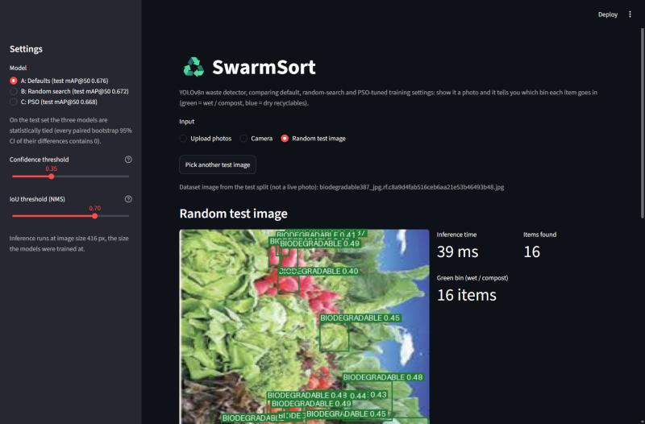
</p>

*Soft Computing course project, Semester V, Unit V: swarm intelligence. (Screenshot from the Generation 1 app; the current app adds a generation switch and a reject bin.)*

---

## Contents

- [At a glance](#at-a-glance)
- [Why this project](#why-this-project)
- [The story in two generations](#the-story-in-two-generations)
- [How it works](#how-it-works)
- [Results](#results)
- [Demo app](#demo-app)
- [Repository structure](#repository-structure)
- [Quick start](#quick-start)
- [Reproducing the experiment](#reproducing-the-experiment)
- [Limitations and future work](#limitations-and-future-work)
- [References and acknowledgements](#references-and-acknowledgements)
- [Author](#author)

## At a glance

| | Generation 1 | Generation 2 |
|---|---|---|
| **Question** | Does PSO beat the defaults on a clean dataset? | Does the same method work on real-world photos, and does real-world data help? |
| **Training data** | Kaggle garbage-detection (studio photos): 7,324 train, 2,094 val | Gen 1 subsample + TACO + HITL Recycling: 6,292 train, 1,841 val |
| **Test sets** | 1,046 studio images | all (1,514), studio (1,046), real_world (468), india (700, DWSD, never trained on) |
| **Classes** | 6: BIODEGRADABLE, CARDBOARD, GLASS, METAL, PAPER, PLASTIC | 7: the same six + OTHER |
| **Model and image size** | YOLOv8n, 416 px | YOLOv8n, 640 px |
| **Arms** | A defaults, B random search, C PSO; B and C get 32 proxy trainings each | the same three arms, same budget |
| **Test mAP@50 (A / B / C)** | 0.676 / 0.672 / 0.668 | all 0.479 / 0.497 / 0.500; real_world 0.310 / 0.298 / 0.310; india 0.027 / 0.023 / 0.027 |
| **Verdict** | A statistical tie: the defaults were already near-optimal | B and C significantly beat A on all and studio; PSO and random search tie; a tie on real_world; every arm fails on india |

**Gen 1 vs Gen 2 on the same images** (6 shared classes, each model at its own image size):

- **Real-world photos:** about 0.05–0.10 test mAP@50 for Gen 1 against about 0.34–0.35 for Gen 2. Every Gen 2 arm is significantly better than every Gen 1 arm.
- **Studio photos:** Gen 2 pays for it with about 0.08–0.10 less test mAP@50 (same arm against same arm). Every Gen 1 arm is significantly better there.

**Speed:** about 31 ms per image on a laptop CPU (Gen 1, Intel Core Ultra 5 125H); 8.0–8.8 ms on a Tesla T4 GPU (Gen 2).

## Why this project

**The problem.** India's Solid Waste Management Rules, 2016 require every household to separate its waste at source: wet (biodegradable) waste in a green bin, dry recyclables in a blue bin, and domestic hazardous waste apart. In practice this is done by hand and often done badly. A camera that recognises each item and names its bin can help at home and at sorting points, but it has to be accurate and light enough for cheap hardware.

**Why hyperparameters matter.** A detector's accuracy depends not only on its architecture but on how it is trained: learning rate, momentum, weight decay and how much data augmentation it sees. These values are not learned from the data. Most projects keep the library defaults or pick values by hand.

**Why PSO.** All six hyperparameters we tune are continuous, and each evaluation is a training run, so we can afford only a few dozen. PSO works directly on real-valued vectors (a move is just a vector addition), has only three main settings (w, c1, c2) with well-known values, and lets every evaluation steer the next round. It is also the swarm-intelligence method studied in Unit V.

**The gap in the base paper.** Our base paper, Majchrowska et al. (2022), detects waste in natural and urban scenes with a two-stage pipeline: an EfficientDet-D2 detector finds the litter, then a separate EfficientNet-B2 classifier labels each item, with hand-chosen hyperparameters. SwarmSort uses a single-stage detector that finds and classifies in one pass, and tests whether a systematic search improves its hyperparameters.

| | Majchrowska et al. (2022) | SwarmSort |
|---|---|---|
| Pipeline | Two-stage: detector + classifier | Single-stage YOLOv8n |
| Hyperparameters | Chosen by hand | Tuned by PSO, compared with defaults and random search at an equal budget |
| Evaluation | Benchmark test sets | Test splits used once, per domain (studio, real-world, India), paired bootstrap 95% CIs |
| Deployment | Not the focus | Laptop CPU, Streamlit demo with bin advice |

## The story in two generations

<p align="center">
  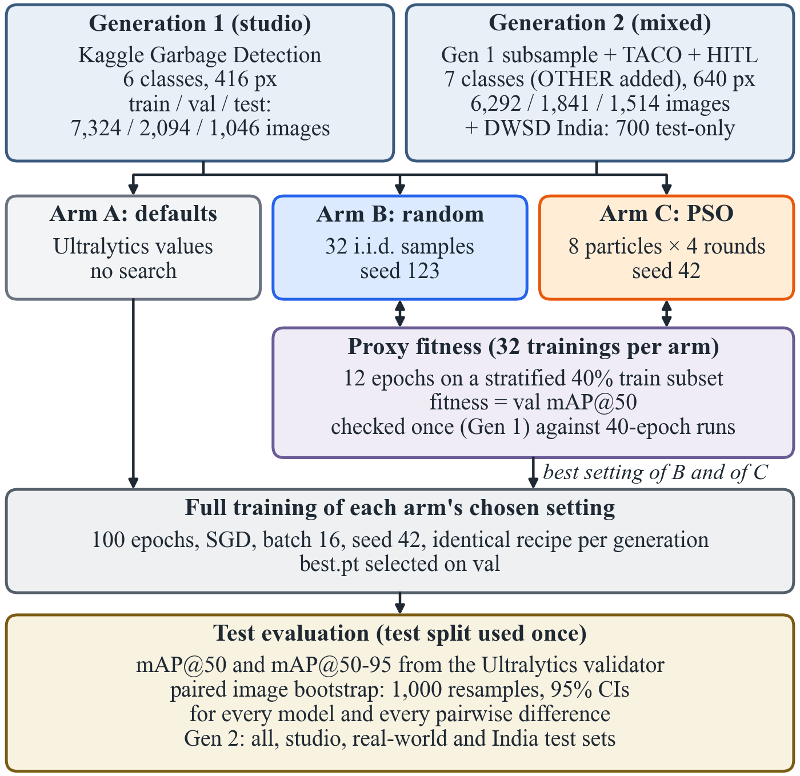
</p>

| | Generation 1 | Generation 2 |
|---|---|---|
| **Dates** | 2026-09-30 to 2026-10-05 | 2026-10-07 to 2026-10-10 (comparison with Gen 1 on 2026-10-11) |
| **Started because** | We wanted to know if PSO tuning helps a small detector | The live demo failed on real street photos (the domain gap) |
| **Changed** | (first version) | Data (real-world litter added), a 7th class (OTHER), image size 640 |
| **Kept** | | Model, search space, PSO, budgets, training recipe, statistics |
| **Answer** | Tuning gave nothing measurable: a tie | Tuning gives a small, real gain (+0.02); real-world accuracy rises sharply; studio accuracy drops |

1. **Generation 1: does PSO beat the defaults?** On a clean, single-object dataset, three arms (defaults, random search, PSO) were compared at an equal search budget and scored once on an untouched test split. The result was a statistical tie (0.676 / 0.672 / 0.668 mAP@50): the defaults were already near the best this model and data allow.
2. **The domain gap.** In the live demo, a real street photo with scattered litter fooled all three models: crumpled polythene and cans came out as GLASS at 0.35–0.5 confidence, and the models disagreed with each other. The training photos were mostly isolated objects on clean backgrounds, and tuning cannot fix missing data.
3. **Generation 2: waste in real places.** Real-world litter photos (TACO, HITL Recycling) were merged with part of the Gen 1 data, an OTHER class was added for items that fit no recyclable class, images went up to 640 px, and an Indian street dataset (DWSD) was kept apart as a test-only set. The same three arms were rerun. Now both searches beat the defaults on the all and studio test sets, and on real-world photos the Gen 2 models score about 4 to 9 times the Gen 1 models' mAP@50. The cost is lower accuracy on clean studio photos, and Indian photos remain unsolved.

The full history, with every decision, incident, fix and lesson, is in [docs/EVOLUTION.md](docs/EVOLUTION.md).

## How it works

Sections 1–8 describe the method shared by both generations (with Gen 1's numbers where they differ); sections 9–13 are what Generation 2 added.

### 1. Dataset and the re-split discovery

Gen 1 uses the Kaggle dataset [Garbage Detection – 6 Waste Categories](https://www.kaggle.com/datasets/viswaprakash1990/garbage-detection) (CC BY 4.0): 10,464 images of 416×416 pixels with YOLO bounding boxes in 6 classes.

Our first verification run showed that the dataset's own train/valid/test folders are **split by class**: valid has no paper or plastic images, and test has no glass, biodegradable or cardboard images. So all images were pooled and re-split 70/20/10, stratified by class (seed 42): **7,324 train, 2,094 val and 1,046 test images**. The split is stored in [configs/split.csv](configs/split.csv), and the dataset files are never modified. Gen 2 keeps this split for every Gen 1 image, so the Gen 1 test images are never trained on.

<p align="center">
  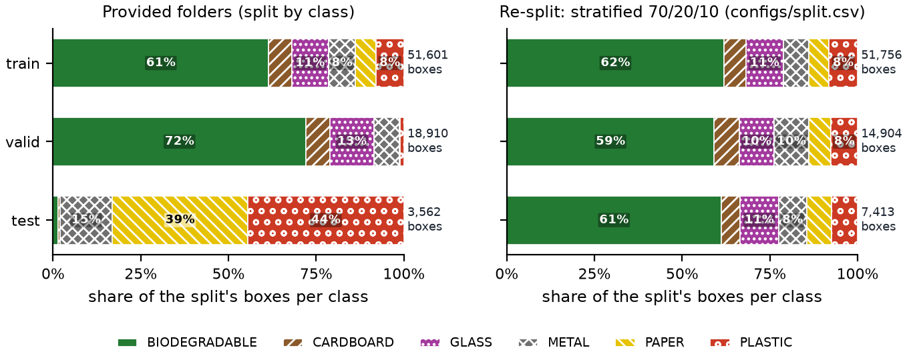
</p>

The re-split is also **duplicate-aware**: copies of the same photo stay in the same split, so nothing leaks from train into test. Two images count as copies if they have the same bytes, come from the same Roboflow source image, have 256-bit dHashes at most 10 bits apart, or have dHashes at most 40 bits apart and 64×64 grayscale thumbnails with a Pearson correlation of at least 0.90. The rules found 138 near-duplicate pairs in 47 groups (133 images), and after the split 0.00% of val and test images have a copy in another split ([results/dataset_report.json](results/dataset_report.json)).

### 2. The detector: YOLOv8n

YOLOv8n is a single-stage detector: one pass over the image predicts boxes and class scores at three scales (strides 8, 16 and 32). It starts from COCO-pretrained weights. Gen 1 trains at 416 px, Gen 2 at 640 px, so small items in wide real-world scenes keep more pixels. Detections are scored with mAP@50 (mean average precision at IoU 0.5) and mAP@50-95 (averaged over IoU 0.50 to 0.95).

<details>
<summary>YOLOv8n architecture diagram</summary>

<p align="center">
  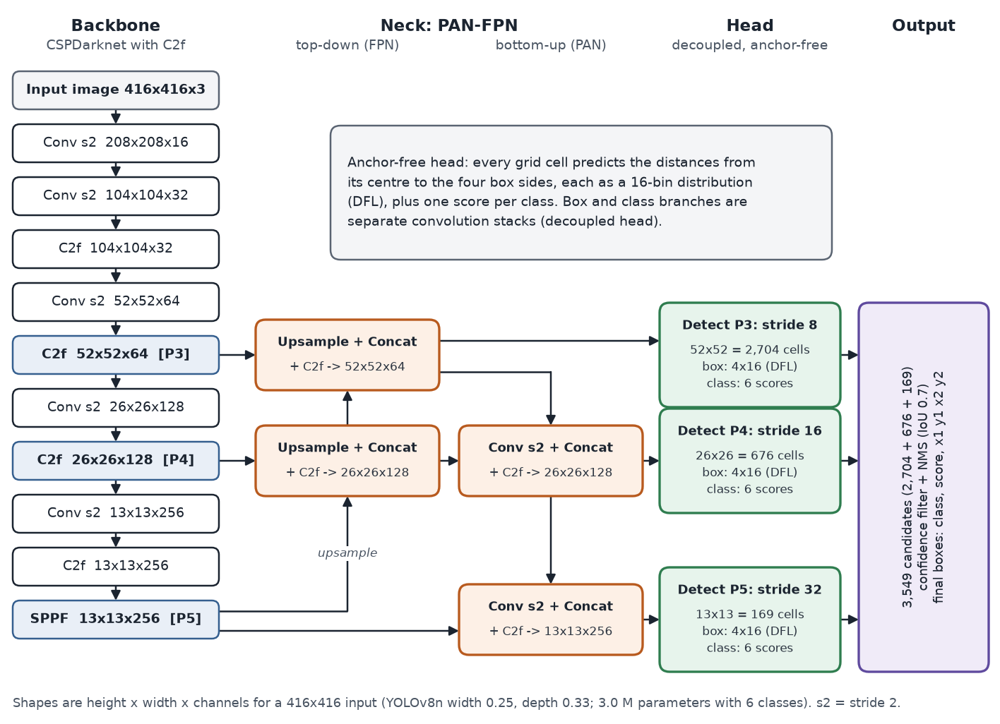
</p>
</details>

### 3. The search space

Six training hyperparameters are searched, with the same bounds in both generations and both search arms ([src/search_space.py](src/search_space.py)). The learning rate and weight decay span two orders of magnitude, so they are searched on a log10 scale (a particle coordinate of −3.2 means lr0 = 10^−3.2).

| Hyperparameter | What it controls | Range | Scale | Default (Arm A) |
|---|---|---|---|---|
| `lr0` | initial learning rate | 1e-4 to 1e-2 | log10 | 0.01 |
| `lrf` | final learning rate as a fraction of `lr0` | 0.01 to 0.2 | linear | 0.01 |
| `momentum` | SGD momentum | 0.60 to 0.98 | linear | 0.937 |
| `weight_decay` | L2 weight decay | 1e-5 to 1e-3 | log10 | 0.0005 |
| `mosaic` | probability of mosaic augmentation | 0 to 1 | linear | 1.0 |
| `scale` | random scaling gain | 0.2 to 0.8 | linear | 0.5 |

### 4. Particle Swarm Optimization

[src/pso.py](src/pso.py) is a hand-written, standard inertia-weight PSO (about 70 lines, numpy only). Each particle is one hyperparameter vector. It remembers the best position it has visited (**pbest**), and the swarm remembers the best position any particle has visited (**gbest**). Every update step moves each particle like this:

```
v = w*v + c1*r1*(pbest - x) + c2*r2*(gbest - x)     # inertia + pull to own best + pull to swarm best
x = x + v
```

| Setting | Value |
|---|---|
| Swarm size × rounds | 8 × 4 = 32 evaluations (round 1 is the random initial swarm, then 3 moves) |
| `c1`, `c2` | 1.5, 1.5 |
| Inertia `w` | falls linearly from 0.9 to 0.4 (0.9, 0.65, 0.4) |
| `r1`, `r2` | uniform on [0, 1], fresh for every particle and dimension |
| Velocity limit | ±20% of each dimension's range |
| Initial state | positions uniform in the bounds, velocities uniform in ±10% of the range |
| Boundaries | positions clipped to the bounds; a clipped dimension's velocity is set to 0 |
| Seed | 42 (random search: seed 123) |

The optimizer has an **ask/tell** interface: `ask()` returns the positions to evaluate and `tell(fitnesses)` updates pbest/gbest and moves the swarm. It never trains a model itself, so the same class runs the benchmark functions and the real search. Before it was trusted with expensive trainings, it was checked on the 6-D Sphere and Rastrigin functions ([results/plots/pso_benchmarks.png](results/plots/pso_benchmarks.png)).

<details>
<summary>PSO flowchart and the Gen 1 swarm in the lr0–momentum plane</summary>

<p align="center">
  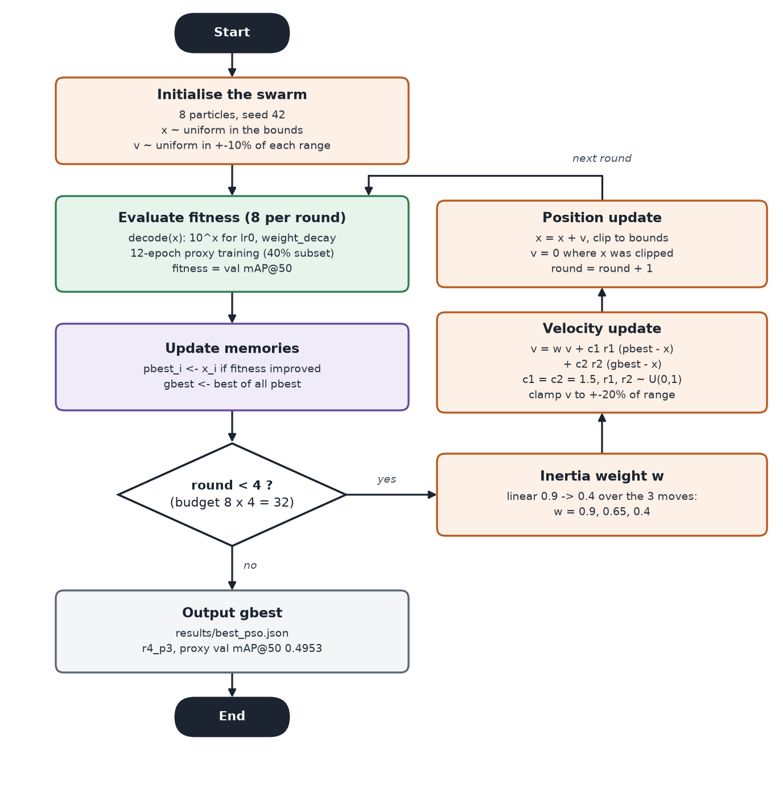
</p>

Left: the Gen 1 PSO swarm, with arrows joining each particle's successive positions; it closes in on one region round by round. Right: the 32 random-search samples, shaded by fitness.

<p align="center">
  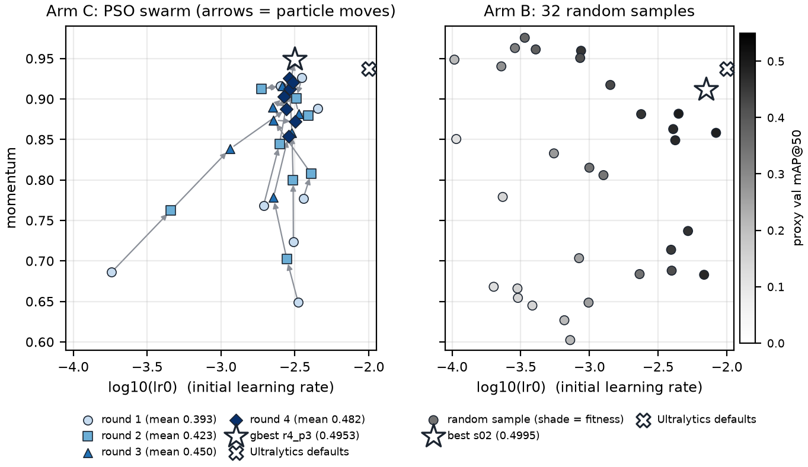
</p>
</details>

### 5. Proxy fitness and its validation

A full training takes one to two hours on a Kaggle Tesla T4, so 64 of them per generation would be far too expensive. Each candidate is instead scored with a **proxy training**: 12 epochs on a stratified 40% subset of the train split, at the generation's image size. Its fitness is the mAP@50 on the full validation split.

<p align="center">
  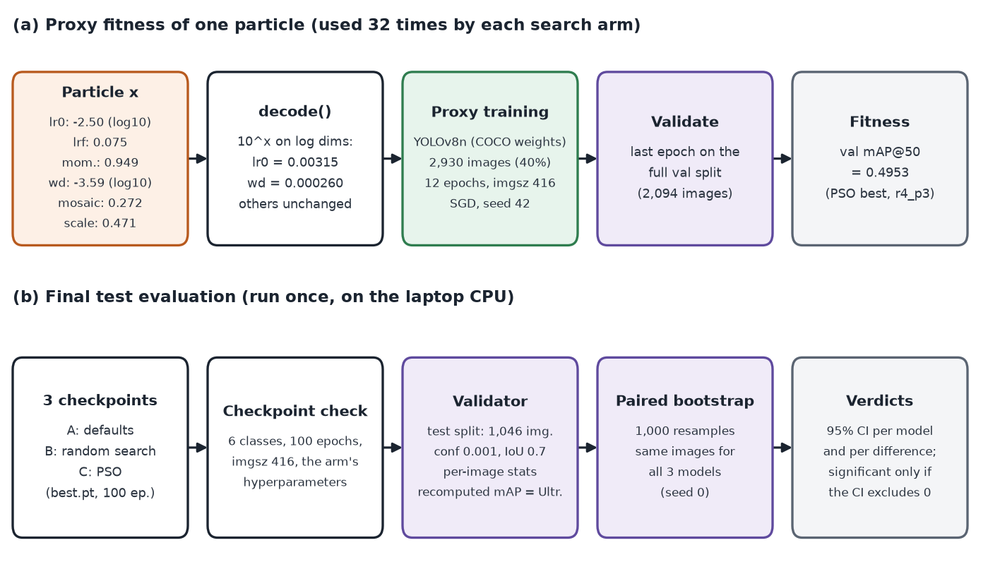
</p>

A proxy is only useful if it ranks candidates the same way a longer training does, so this was tested in Gen 1 before any search. Seven Latin-hypercube configurations plus the defaults were each trained twice: as a proxy and as a 40-epoch run on the full train split. The rule, fixed in advance, was to accept the proxy if the Spearman rank correlation is at least 0.6. The result was **ρ = 0.976** (n = 8), so the proxy was accepted ([results/proxy_check.json](results/proxy_check.json)). Gen 2 kept the same proxy recipe and did not repeat the check (decision of 2026-10-07).

### 6. Full training recipe

Every full training (A, and the winners of B and C) uses the same recipe within a generation; only the six searched values differ:

- 100 epochs, batch 16, pretrained `yolov8n.pt`; imgsz 416 (Gen 1) or 640 (Gen 2)
- explicit SGD, seed 42, deterministic mode; `best.pt` is picked on the val split
- warmup 3 epochs and mosaic closed for the last 10 epochs (both scale with the number of epochs, so proxy and full runs follow the same schedule)

Two Ultralytics defaults are avoided on purpose: `optimizer=auto` ignores `lr0` and `momentum` (which would make the search pointless), and `fraction` keeps the first N sorted images instead of a random sample.

### 7. Test evaluation with a paired bootstrap

Each test split was used **exactly once**, for the final comparison; the searches and all checks used only train and val. [src/evaluate.py](src/evaluate.py) first checks every checkpoint (class names, 100 epochs, image size and its arm's hyperparameters, so a model in the wrong slot is refused), then scores it with Ultralytics' own validator (conf 0.001, IoU 0.7).

Small differences between arms can be pure luck in which images landed in the test split. A **paired bootstrap** measures this: the test images are resampled with replacement 1,000 times (seed 0), each resample is scored for all models on the same images, and the 2.5th and 97.5th percentiles give a 95% confidence interval for each model and each difference. A difference counts as significant only if its interval excludes 0.

The arms are read from a table: Gen 1 is built in, Gen 2 uses [configs/gen2/arms.yaml](configs/gen2/arms.yaml) (`--arms`). `--tag` names the outputs per test set (`test_<tag>_results.json`), and `--classes` restricts the predictions to some classes (section 12).

### 8. System architecture

<p align="center">
  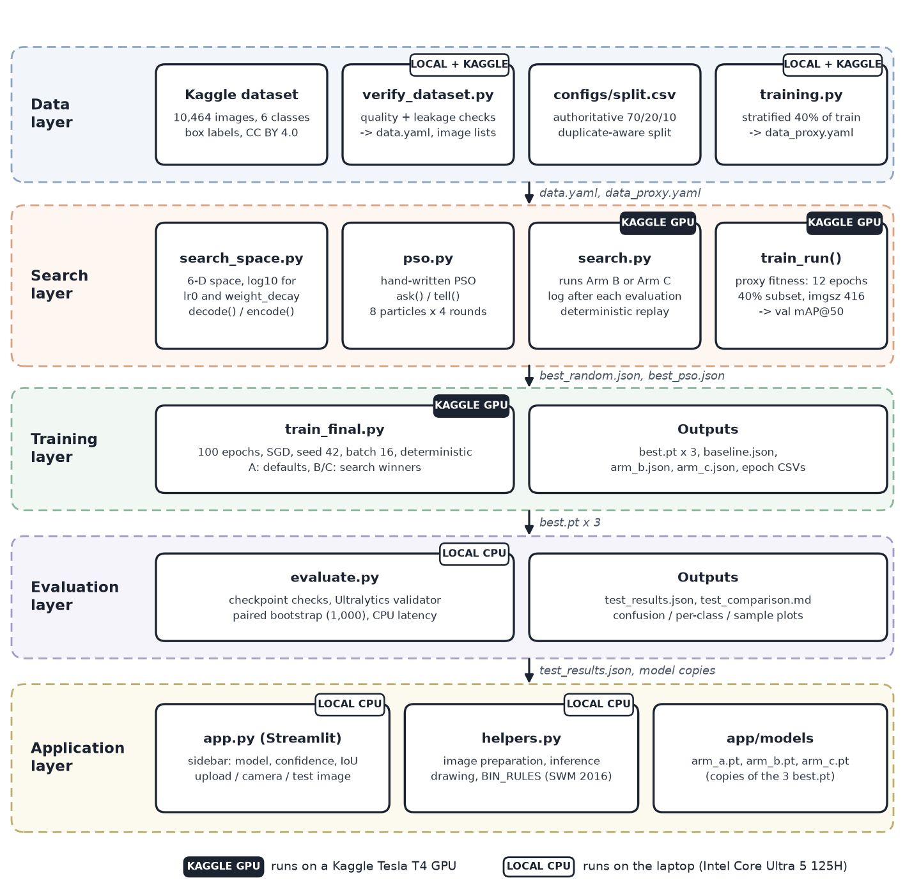
</p>

The GPU-heavy parts (baseline, proxy check, both searches, full trainings, and in Gen 2 also the dataset build and the test evaluation) run in Kaggle notebooks on Tesla T4 GPUs. Gen 1's dataset check and test evaluation, and the demo app, run on a laptop CPU.

### 9. Gen 2: the multi-source dataset builder

[src/build_dataset.py](src/build_dataset.py) merges several datasets in different formats into one YOLO dataset, driven by [configs/gen2/sources.yaml](configs/gen2/sources.yaml):

| Source | Format | Licence | Images used | Role | Domain |
|---|---|---|---|---|---|
| Gen 1 garbage-detection | YOLO | CC BY 4.0 | 3,000 train + 900 val (seeded, class-stratified sample) + all 1,046 Gen 1 test images | train / val / test | `studio` |
| TACO (official set) | COCO | CC BY 4.0 | 1,500 images, 4,784 boxes | train / val / test | `real_world` |
| HITL Recycling | Supervisely JSON | CC0 | 3,201 images, about one box each | train / val / test | `real_world` |
| DWSD (Kolkata streets) | grey-level semantic masks | CC BY 4.0 | 700 of 784 images (those with a box) | **test only** | `india` |

- **Class mapping.** Every source class is mapped to one of the 7 targets or dropped explicitly; an unmapped class is an error. All 60 TACO categories map to a class. HITL takes the class from its Material tag, with Object-tag overrides first (for example cigarette butt → OTHER); objects without a Material tag become OTHER.
- **EXIF fix.** Phone photos store their rotation in EXIF. The builder applies it, converts COCO and Supervisely boxes to the rotated frame (deciding per image whether the boxes refer to the raw or the displayed photo), drops the EXIF so no loader rotates twice, and stores every image as JPEG with a long side of at most 640 px (153 TACO and 1,077 HITL images were rotated).
- **Split.** The Gen 1 duplicate rules run across all sources; duplicate groups are split 70/20/10, stratified by source and dominant class, and Gen 1 images keep their Gen 1 split. Result: 962 duplicate groups (1,954 images, none spanning two sources), 6,292 train, 1,841 val and 1,514 test images ([results/gen2/build_report.json](results/gen2/build_report.json)).
- **Per-domain test sets.** `data_test_studio.yaml` (1,046 images, the Gen 1 test split), `data_test_real_world.yaml` (468 images, TACO + HITL) and `data_test_india.yaml`, so each domain is scored on its own.
- **DWSD semantic masks.** DWSD publishes masks, not boxes. The `semantic_mask` reader turns every connected region of one class value into one box (8-connectivity, regions under 50 pixels dropped). Touching items of one class therefore merge into one large box. The published value-to-class table matches the masks' pixel counts but not their content, so the mapping was inferred from the images. DWSD was added late, so it is built on its own at evaluation time (`--only dwsd`); an MD5 cross-check found 0 identical files against the 9,647 main-build images.
- A **relocate mode** rewrites the lists and yamls of a finished build attached read-only on Kaggle, so later notebooks reuse it without copying it.

### 10. Gen 2: the OTHER class

Real litter includes items that are none of the six recyclable materials: cigarette butts, unidentified litter, mixed bin bags, textile and rubber, hazardous items, multi-layer blister packs. Dropping them would teach the model that they are background, so Gen 2 adds a narrow catch-all class, **OTHER** (index 6; Gen 1's six keep indices 0–5). The app sends it to a reject bin. OTHER turned out very weak (test AP@50 0.050–0.063, all 132 test boxes in real_world).

### 11. Gen 2: the exact fast bootstrap

The first Gen 2 evaluation ran 3.6 hours without finishing: the bootstrap re-sorted hundreds of thousands of predictions (at conf 0.001) for every resample. `evaluate.py` now computes an **exact weighted bootstrap**: each image is weighted by how often it was drawn, and the predictions are sorted once, so a resample only needs weighted hit/miss counts along that fixed order. It gives the same numbers as Ultralytics' `ap_per_class` (unit tests and a real val run match), apart from confidence ties where that reference itself orders predictions arbitrarily; a built-in check rescores the first resamples the slow way (largest gap 3.5e-4 mAP on the final runs). It was 10× faster on that run and 29× on a Gen 2-sized set.

### 12. Gen 2: a fair Gen 1 vs Gen 2 comparison

Gen 1's test score (0.676) and Gen 2's studio score (0.571–0.595) cannot be compared directly: 6 vs 7 classes, 416 vs 640 px, and Gen 2 trained on only 3,000 of the 7,324 Gen 1 training images. So all six final models were scored on the **same test images with the same labels** ([configs/gen2/arms_gen1_vs_gen2.yaml](configs/gen2/arms_gen1_vs_gen2.yaml)):

- **6 shared classes.** [src/compare_generations.py](src/compare_generations.py) `subset` writes a copy of each test set with the OTHER label lines removed (images that had only OTHER stay in, with no objects, for every model).
- **OTHER predictions dropped.** `evaluate.py --classes 0 1 2 3 4 5` keeps only the shared classes in the NMS. Ultralytics 8.4.169's validator silently ignores `classes=` (its predictor passes it to the NMS, its validator does not), so `evaluate.py` adds the filter in its own validator subclass, the same filter as `predict(classes=...)`.
- **Each model as deployed.** Gen 1 models run at 416 px, Gen 2 models at 640 px.
- The same paired bootstrap covers all 15 pairs of the six models.

### 13. Gen 2: Kaggle robustness

Two Gen 2 runs froze on 2026-10-08 about 55 minutes into training, with no error, until Kaggle's 12-hour limit (about 24 GPU hours lost); the attached input mount most likely stopped answering. Every GPU notebook now:

1. **copies the dataset to local disk** first, checking names and sizes, and fails loudly if the copy stalls for 2 minutes;
2. runs each script under a **stall watchdog** ([src/watchdog_run.py](src/watchdog_run.py)): 20 minutes without output or file changes kills the whole process group and restarts it, at most 3 times;
3. **resumes** stopped work: `search.py` replays its log, and `train_final.py --resume` continues `last.pt` after checking that its training arguments match.

Training arguments were not changed, so the results stay comparable. The random search resumed from 11 of 32 evaluations and Arm C from epoch 55.

## Results

Every number below comes from the JSON files in [results/](results/) and [results/gen2/](results/gen2/).

### Generation 1: a statistical tie

**Search (proxy, val mAP@50).** Both searches beat the defaults on the proxy. The PSO swarm converged: its mean fitness per round rose from 0.393 to 0.482. Random search found its best point on its second sample, and 28 of its 32 samples scored below the defaults.

| | A: Defaults | B: Random search | C: PSO |
|---|---|---|---|
| Proxy val mAP@50 | 0.4765 | **0.4995** | 0.4953 |
| `lr0` / `lrf` | 0.01 / 0.01 | 0.00702571 / 0.0625491 | 0.00315345 / 0.0751247 |
| `momentum` / `weight_decay` | 0.937 / 0.0005 | 0.911507 / 0.000602262 | 0.949322 / 0.000259703 |
| `mosaic` / `scale` | 1.0 / 0.5 | 0.51297 / 0.346979 | 0.271828 / 0.470742 |
| Search time (Tesla T4) | none | 2.12 h | 1.91 h |
| Full training val mAP@50 (100 epochs) | 0.657 | 0.643 | 0.657 |

**Test split** (1,046 images, 7,415 boxes, used once). 95% CIs from 1,000 paired bootstrap resamples; latency is the median batch-1 time at 416 px on a laptop CPU. Full tables: [results/test_comparison.md](results/test_comparison.md).

| Arm | test mAP@50 [95% CI] | test mAP@50-95 [95% CI] | Precision | Recall | ms/img |
|---|---|---|---|---|---|
| A: Defaults | **0.676** [0.639, 0.722] | 0.474 [0.441, 0.518] | 0.747 | 0.581 | 31.4 |
| B: Random search | 0.672 [0.634, 0.717] | 0.475 [0.441, 0.519] | 0.746 | 0.587 | 38.3 |
| C: PSO | 0.668 [0.627, 0.717] | 0.471 [0.437, 0.516] | 0.747 | 0.586 | 31.7 |

| Pair | Δ mAP@50 [95% CI] | Δ mAP@50-95 [95% CI] | Verdict |
|---|---|---|---|
| B − A | −0.004 [−0.016, +0.009] | +0.001 [−0.008, +0.010] | not significant |
| C − A | −0.008 [−0.021, +0.007] | −0.003 [−0.012, +0.007] | not significant |
| C − B | −0.004 [−0.015, +0.007] | −0.003 [−0.011, +0.004] | not significant |

Every difference interval contains 0, so this test split cannot tell the three arms apart. Per class, PSO's model is slightly better on BIODEGRADABLE (0.643) and GLASS (0.765) and clearly worse on PLASTIC (0.638, against 0.699 for A); the gains and losses roughly cancel out.

<details>
<summary>Gen 1 plots: search convergence, training curves, per-class AP</summary>

<p align="center">
  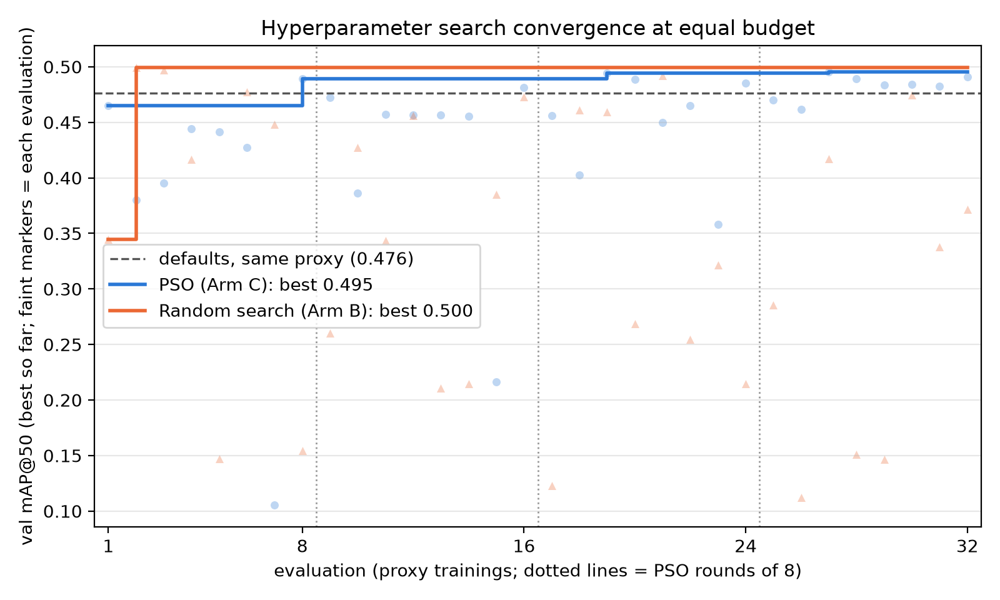
</p>
<p align="center">
  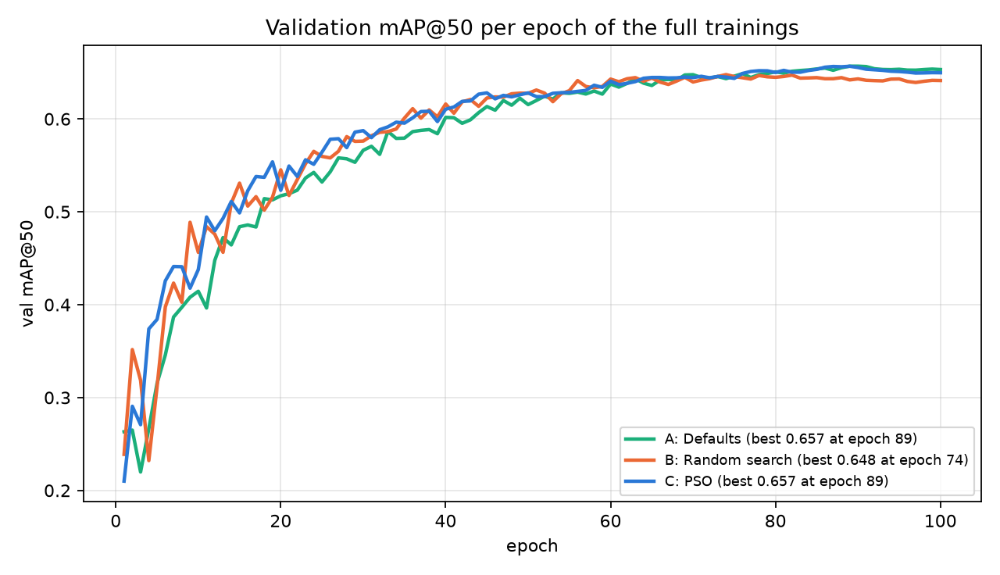
</p>
<p align="center">
  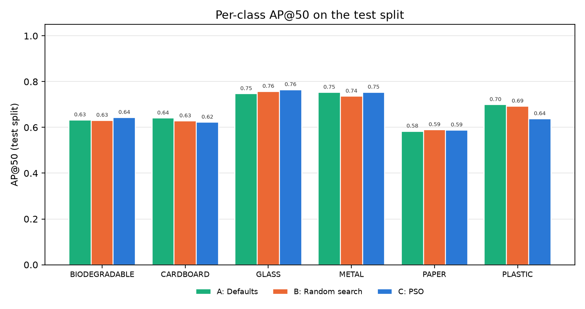
</p>

Sample detections: [results/plots/test_samples.jpg](results/plots/test_samples.jpg); confusion matrices: [results/plots/test_confusion.png](results/plots/test_confusion.png).
</details>

### Generation 2: tuning helps, per domain

**Search and full training.** As in Gen 1, both searches found their best point early: random search on evaluation 3 (proxy val mAP@50 0.33401), PSO in round 1 (0.32901). The swarm still converged: its round means rose every round (0.267, 0.286, 0.300, 0.319). On the full 100-epoch trainings both tuned arms were ahead of the defaults on val, unlike in Gen 1.

| | A: Defaults | B: Random search | C: PSO |
|---|---|---|---|
| Best proxy val mAP@50 | none | 0.33401 | 0.32901 |
| `lr0` / `lrf` | 0.01 / 0.01 | 0.00445126 / 0.050615 | 0.00251495 / 0.0693497 |
| `momentum` / `weight_decay` | 0.937 / 0.0005 | 0.881757 / 0.00018192 | 0.916259 / 0.000406938 |
| `mosaic` / `scale` | 1.0 / 0.5 | 0.927407 / 0.339145 | 0.387478 / 0.372997 |
| Search time (Tesla T4) | none | 2.30 h | 2.54 h |
| Full training val mAP@50 | 0.4535 | 0.4734 | 0.4662 |
| Full training time (Tesla T4) | 1.56 h | 2.07 h | 1.60 h |

**Test splits** (used once, 640 px, 1,000 paired bootstrap resamples). Test mAP@50 [95% CI]:

| Arm | all (1,514 images) | studio (1,046) | real_world (468) | india (700) |
|---|---|---|---|---|
| A: Defaults | 0.479 [0.453, 0.513] | 0.571 [0.529, 0.619] | 0.310 [0.278, 0.440] | 0.027 [0.024, 0.031] |
| B: Random search | 0.497 [0.471, 0.531] | 0.595 [0.557, 0.639] | 0.298 [0.271, 0.407] | 0.023 [0.021, 0.027] |
| C: PSO | **0.500** [0.474, 0.534] | 0.590 [0.550, 0.635] | 0.310 [0.279, 0.415] | 0.027 [0.024, 0.031] |

Pairwise differences in test mAP@50 [95% CI]; **bold** = significant. The mAP@50-95 verdicts are the same in every case.

| Pair | all | studio | real_world | india |
|---|---|---|---|---|
| B − A | **+0.017** [+0.006, +0.030] | **+0.024** [+0.009, +0.038] | −0.012 [−0.118, +0.053] | **−0.003** [−0.006, −0.001] |
| C − A | **+0.020** [+0.011, +0.032] | **+0.019** [+0.005, +0.033] | +0.001 [−0.111, +0.065] | +0.000 [−0.003, +0.003] |
| C − B | +0.003 [−0.008, +0.015] | −0.005 [−0.018, +0.009] | +0.013 [−0.015, +0.036] | **+0.003** [+0.001, +0.006] |

<p align="center">
  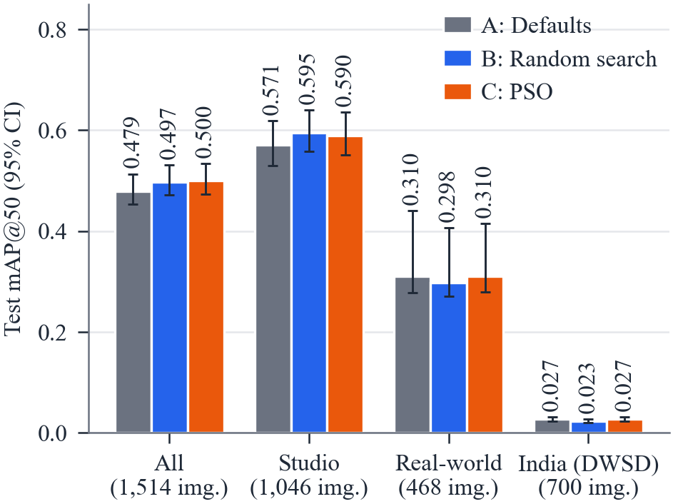
</p>

- **all and studio:** random search and PSO both beat the defaults by about 0.02 mAP@50; PSO and random search cannot be told apart.
- **real_world:** no difference is significant. The intervals are wide and lopsided because BIODEGRADABLE has a single box in this split, so one image swings one of the seven class APs.
- **india:** all three models fail (0.023–0.027). The significant gaps are a few thousandths on scores near zero and mean nothing in practice. Causes: no Indian training images, augmented-looking DWSD photos, mask-derived boxes that merge touching items (so correct per-item detections get a low IoU), and an inferred class mapping.
- **Per class (all split):** PSO is best on five of seven classes (CARDBOARD, GLASS, METAL, PAPER, OTHER), random search on two; OTHER stays at 0.050–0.063 for every arm.

Speed: 8.0–8.8 ms per image (batch 1, 640 px, Tesla T4) for every arm on every split. Per-domain tables: [results/gen2/test_domains.md](results/gen2/test_domains.md).

<details>
<summary>Sample Gen 2 detections on studio, real-world and India test images</summary>

<p align="center">
  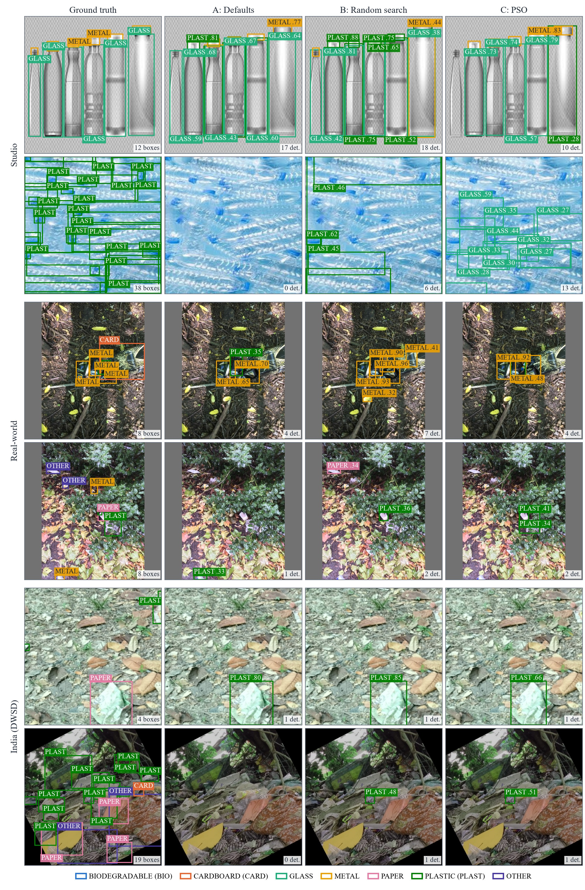
</p>
</details>

### Gen 1 vs Gen 2 on the same images

All six models on the same test images, 6 shared classes (OTHER removed), each model at its own training size. Test mAP@50 and mAP@50-95 [95% CI]. Full tables: [results/gen2/test_g1g2_real_world_comparison.md](results/gen2/test_g1g2_real_world_comparison.md), [results/gen2/test_g1g2_studio_comparison.md](results/gen2/test_g1g2_studio_comparison.md).

**real_world** (468 images, 647 boxes; Gen 1 never saw these sources):

| Arm | mAP@50 | mAP@50-95 |
|---|---|---|
| Gen 1 A: Defaults (416 px) | 0.047 [0.038, 0.080] | 0.036 [0.029, 0.063] |
| Gen 1 B: Random search (416 px) | 0.038 [0.031, 0.069] | 0.029 [0.024, 0.053] |
| Gen 1 C: PSO (416 px) | 0.096 [0.041, 0.214] | 0.069 [0.031, 0.153] |
| Gen 2 A: Defaults (640 px) | **0.353** [0.315, 0.504] | 0.290 [0.258, 0.428] |
| Gen 2 B: Random search (640 px) | 0.338 [0.304, 0.473] | 0.272 [0.243, 0.389] |
| Gen 2 C: PSO (640 px) | 0.352 [0.315, 0.485] | 0.282 [0.251, 0.392] |

**studio** (1,046 images, 7,413 boxes; Gen 1's own test split, which neither generation trained on):

| Arm | mAP@50 | mAP@50-95 |
|---|---|---|
| Gen 1 A: Defaults (416 px) | **0.676** [0.641, 0.719] | 0.474 [0.442, 0.514] |
| Gen 1 B: Random search (416 px) | 0.672 [0.636, 0.716] | 0.475 [0.443, 0.516] |
| Gen 1 C: PSO (416 px) | 0.669 [0.628, 0.716] | 0.471 [0.438, 0.513] |
| Gen 2 A: Defaults (640 px) | 0.571 [0.529, 0.619] | 0.386 [0.356, 0.425] |
| Gen 2 B: Random search (640 px) | 0.595 [0.557, 0.639] | 0.404 [0.374, 0.442] |
| Gen 2 C: PSO (640 px) | 0.590 [0.550, 0.635] | 0.398 [0.367, 0.439] |

Gen 2 arm − Gen 1 arm (same letter), Δ test mAP@50 [95% CI]:

| Arm | real_world | studio |
|---|---|---|
| A: Defaults | **+0.305** [+0.266, +0.453] | **−0.105** [−0.125, −0.084] |
| B: Random search | **+0.301** [+0.265, +0.419] | **−0.078** [−0.100, −0.056] |
| C: PSO | **+0.256** [+0.142, +0.424] | **−0.079** [−0.100, −0.057] |

All 18 cross-generation differences (every Gen 2 arm against every Gen 1 arm, on both sets) are significant, on mAP@50 and on mAP@50-95: on real_world Gen 2 leads by +0.243 to +0.315, on studio Gen 1 leads by 0.074 to 0.105. Within each generation the earlier verdicts hold (no difference on real_world; in Gen 2, B and C beat A on studio). Gen 1 C's 0.096 on real_world rests largely on the single BIODEGRADABLE box (its AP 0.332 on that box). Gen 1's studio scores reproduce its own test run (0.676 / 0.672 / 0.669 against 0.676 / 0.672 / 0.668).

### What we learned

- **Gen 1: a tie.** On clean studio data, defaults, random search and PSO are statistically indistinguishable. Ultralytics' defaults were already near-optimal there, and PSO, although it worked as an optimizer (benchmarks passed, swarm converged, beat the defaults on a validated proxy), had very little room to improve.
- **The proxy gap.** The proxy ranked very different configurations almost perfectly (ρ = 0.976), but the top candidates were within about 0.02 on it, and that edge faded over 100 epochs: Gen 1 random search's winner had the best proxy score yet a lower val mAP@50 than the defaults (0.643 against 0.657).
- **Gen 2: tuning helps when there is room.** On harder, mixed data both searches beat the defaults by about 0.02 mAP@50, significant on the all and studio splits. PSO and random search tie again, for the second generation running.
- **Data first.** Real-world training data lifted real-world mAP@50 about 4 to 9 times; a domain with no training data (India) fails whatever the tuning. Tuning cannot fix missing data.
- **There is a trade-off.** The same small model, trained on 41% of the studio images plus real-world scenes and a 7th class, lost about 0.08–0.10 on studio photos. The likely causes are not separated by this run.
- **Report each domain separately, and count boxes first.** The all split is mostly studio boxes (7,413 of 8,192) and hides the real-world story; one BIODEGRADABLE box made the real-world intervals lopsided.
- **Compare like with like.** Only scoring every model on the same images and classes answered whether Gen 2 improved.
- **A negative result, reported as it is.** Equal budgets, one fixed recipe, test splits used once and a paired bootstrap are what make both the tie and the gains believable.

## Demo app

<p align="center">
  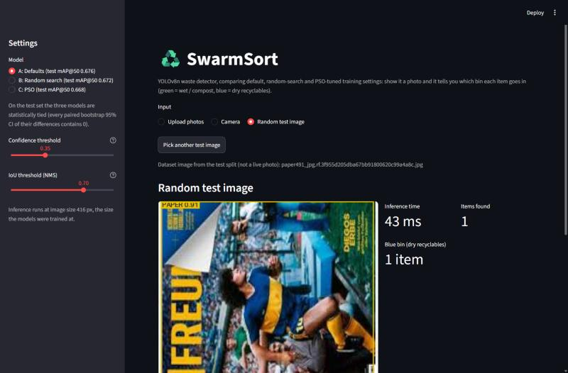
</p>

*Screenshot from the Generation 1 app; the sidebar now also has a generation switch.*

```bash
.venv/Scripts/python -m streamlit run app/app.py
```

The Streamlit app opens in the browser. It works from a fresh clone, because all six trained models are committed: Gen 1 in [app/models/](app/models/), Gen 2 in `app/models/gen2/` (sources and checksums in [app/models/README.md](app/models/README.md)).

**Features**

- **Generation switch:** Generation 2 (real-world data, 7 classes; the default) or Generation 1 (studio data, 6 classes). Each generation remembers its own arm.
- **Model:** arm A, B or C, labelled with its test mAP@50; the default is the arm with the highest test mAP@50 (Gen 2: C, 0.500 on the all set; Gen 1: A, 0.676). The sidebar shows that generation's pairwise verdict.
- **Image size per model:** each model runs at the size stored in its checkpoint (416 px for Gen 1, 640 px for Gen 2), shown in the sidebar.
- **Input:** upload one or more photos (JPG, PNG, WebP), take one with the camera, or pick a random studio test image (when the Gen 1 dataset is present locally).
- **Output:** a box and a "CLASS 0.87"-style label for every item, the inference time, a table of items with their bin and a disposal tip, and the number of items per bin.
- **Box colours:** green only for biodegradable items, near-black for OTHER; the dry types use colours that are neither green nor blue, so a box colour is never mistaken for a bin colour.
- **Thresholds:** confidence (default 0.35) and NMS IoU (default 0.7).
- **About panel:** both generations' test tables, including Gen 2's per-domain scores.

**Bin rules** follow India's Solid Waste Management Rules, 2016 (`BIN_RULES` in [app/helpers.py](app/helpers.py)):

| Item | Bin | Disposal tip |
|---|---|---|
| BIODEGRADABLE | Green bin (wet / compost) | Compost |
| PAPER | Blue bin (dry recyclables) | Paper recycling; keep it dry and clean |
| CARDBOARD | Blue bin (dry recyclables) | Paper recycling; flatten boxes |
| PLASTIC | Blue bin (dry recyclables) | Plastic recycling; rinse containers |
| METAL | Blue bin (dry recyclables) | Metal recycling; rinse cans |
| GLASS | Blue bin (dry recyclables) | Glass recycling; handle with care, keep separate if broken |
| OTHER (Gen 2 only) | Reject bin (non-recyclable / check local rules) | Not recyclable (cigarette butts, dirty mixed litter, textiles); take batteries, medicines or sharps to a domestic hazardous waste drop-off |

<details>
<summary>How the app processes a photo</summary>

<p align="center">
  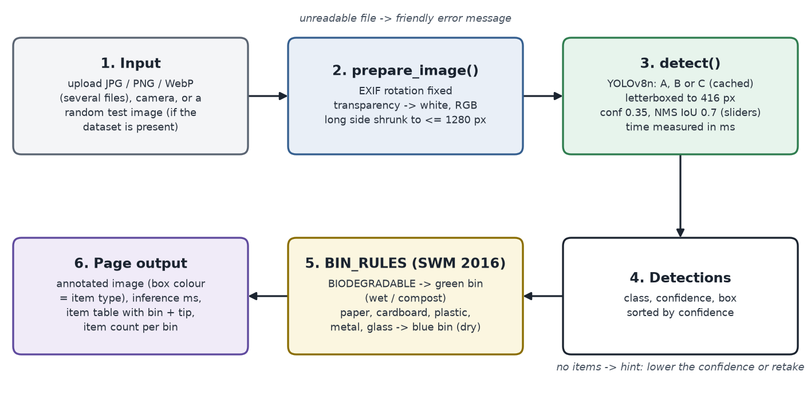
</p>
</details>

## Repository structure

```
SwarmSort/
├── app/
│   ├── app.py                 Streamlit demo app (generation switch, model, thresholds)
│   ├── helpers.py             generations, BIN_RULES, image handling, inference, drawing
│   └── models/                Gen 1 arm_a.pt, arm_b.pt, arm_c.pt (+ README with checksums)
│       └── gen2/              Gen 2 arm_a.pt, arm_b.pt, arm_c.pt
├── configs/
│   ├── split.csv              Gen 1's authoritative 70/20/10 duplicate-aware split
│   └── gen2/
│       ├── sources.yaml       Gen 2 sources, formats, class maps, domains, licences
│       ├── arms.yaml          Gen 2 arms table for evaluate.py
│       └── arms_gen1_vs_gen2.yaml   all six arms, for the Gen 1 vs Gen 2 comparison
├── docs/
│   ├── EVOLUTION.md           both generations: data, method, results, problems, lessons
│   ├── FUTURE_WORK.md         improvement list with status
│   ├── RELATED_WORK.md        papers for the research paper and the gaps SwarmSort fills
│   └── images/                diagrams and screenshots used in this README
├── notebooks/
│   ├── phase*.ipynb           Gen 1 Kaggle notebooks (Phases 2, 4 and 5)
│   └── gen2/                  Gen 2 Kaggle notebooks g2_0 ... g2_7 (+ README with run order and run log)
├── results/
│   ├── dataset_report.json, baseline.json, proxy_check.json   Gen 1 dataset, Arm A, proxy check
│   ├── search_*.json, best_*.json, arm_b.json, arm_c.json     Gen 1 searches and full trainings
│   ├── test_results.json, test_comparison.md                  Gen 1 test evaluation
│   ├── plots/                 Gen 1 convergence, training curves, per-class AP, confusion, samples
│   └── gen2/
│       ├── build_report.json  Gen 2 dataset build
│       ├── arm_*.json, search_*.json, best_*.json   Gen 2 searches and full trainings (+ *_epochs.csv)
│       ├── test_{all,studio,real_world,india}_*     Gen 2 test evaluation per domain, test_domains.md
│       └── test_g1g2_{real_world,studio}_*          Gen 1 vs Gen 2 on the same images
├── src/
│   ├── verify_dataset.py      Gen 1 dataset checks, re-split, data.yaml
│   ├── build_dataset.py       Gen 2 multi-source builder (YOLO, COCO, Supervisely, Labelme, semantic masks)
│   ├── training.py            shared training helpers; stratified 40% proxy subset; resume check
│   ├── train_final.py         one full 100-epoch training; --resume continues last.pt
│   ├── proxy_check.py         does the proxy rank like a longer training?
│   ├── search_space.py        the 6-D search space (bounds, log scale, encode/decode)
│   ├── pso.py                 the hand-written PSO (ask/tell)
│   ├── pso_benchmark.py       PSO check on Sphere and Rastrigin
│   ├── search.py              one search arm (PSO or random), resumable
│   ├── plot_search.py         convergence plot of both arms
│   ├── evaluate.py            test evaluation, exact paired bootstrap; --arms, --tag, --classes
│   ├── compare_generations.py 6-class test subsets and the Gen 1 vs Gen 2 summary
│   └── watchdog_run.py        Kaggle freeze protection: local data copy, stall watchdog with retry
├── tests/                     unittest: app, build_dataset, compare_generations, evaluate, plot_search,
│                              pso, resume, search, watchdog
├── report/SwarmSort_Report.docx   the Generation 1 project report
├── paper/                     research paper (LaTeX sources, figures and their scripts)
└── requirements.txt
```

## Quick start

```bash
git clone https://github.com/Shreyansh303/SwarmSort.git
cd SwarmSort
python -m venv .venv
.venv/Scripts/python -m pip install -r requirements.txt     # on Linux/macOS: .venv/bin/python

.venv/Scripts/python -m streamlit run app/app.py             # the demo (no dataset or GPU needed)
.venv/Scripts/python -m unittest discover -s tests -v        # the tests
```

Some tests run a short CPU training (for example the resume test); set `SWARMSORT_SKIP_SLOW=1` to skip them. The "random test image" input of the app appears only when the Gen 1 dataset is present locally (see Phase 1 below).

## Reproducing the experiment

GPU work runs in Kaggle notebooks; everything else runs locally. Gen 1 runs in six phases with the notebooks in [notebooks/](notebooks/); Gen 2 runs in eight notebooks in [notebooks/gen2/](notebooks/gen2/).

<p align="center">
  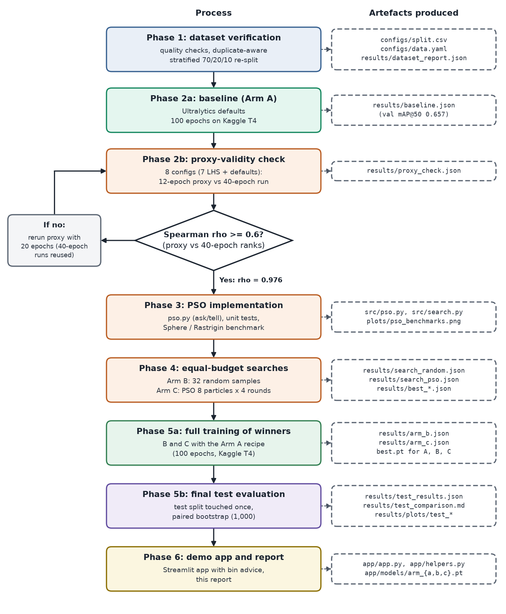
</p>

**Kaggle settings for every notebook:** Accelerator GPU T4 x2 (the same accelerator in every phase), Internet on, the required datasets attached. Start each notebook with **Save Version → Save & Run All** so it keeps running with the browser closed. Each notebook clones this repository and installs the pinned Ultralytics version. A `.pt` file downloads as a `.zip`, because a torch checkpoint is itself a zip archive: rename it to `best.pt`, do not unzip it.

### Generation 1

<details>
<summary><b>Phase 1: dataset verification</b> (local)</summary>

Download the dataset from Kaggle and extract it into the project folder (it is git-ignored). Then:

```bash
.venv/Scripts/python src/verify_dataset.py --root "GARBAGE CLASSIFICATION"
```

This reuses `configs/split.csv`, runs the quality checks and writes `configs/data.yaml` and `configs/lists/` (the Ultralytics dataset config for this machine), `results/dataset_report.json` and the label-check grids in `results/plots/label_check/`.

On Kaggle, `--root /kaggle/input` finds the dataset folder automatically. If the split file is missing, the default `--split auto` stops with an error instead of falling back to the dataset's own folders; `--split provided` checks those folders on purpose, and `--split new` regenerates the split. `configs/split.csv` is authoritative: near-duplicate detection depends on the Pillow version, so always reuse the committed file.
</details>

<details>
<summary><b>Phase 2: baseline (Arm A) and proxy-validity check</b> (Kaggle)</summary>

Notebooks: `phase2a_baseline.ipynb` (about 1 hour) and `phase2b_proxy_check.ipynb` (about 3 hours). They run:

```bash
.venv/Scripts/python src/train_final.py   # Arm A: defaults, 100 epochs -> results/baseline.json
.venv/Scripts/python src/training.py      # stratified 40% train subset -> configs/data_proxy.yaml
.venv/Scripts/python src/proxy_check.py   # -> results/proxy_check.json
```

The proxy check trains 7 Latin-hypercube configurations plus the defaults twice each and accepts the proxy if the Spearman correlation of their val mAP@50 is at least 0.6 (with 8 points a practical check, so the p-value is reported too). If it fails, rerun with `--proxy-epochs 20`; the 40-epoch runs are reused. The log is saved after every finished run, so a dropped session loses at most one run. `--smoke` runs a tiny CPU version.

Bring back: `results/baseline.json`, `results/baseline_epochs.csv`, `results/proxy_check.json`.
</details>

<details>
<summary><b>Phase 3: PSO implementation and checks</b> (local)</summary>

```bash
.venv/Scripts/python src/pso_benchmark.py                   # Sphere and Rastrigin -> results/plots/pso_benchmarks.png
.venv/Scripts/python -m unittest discover -s tests -v       # unit tests
.venv/Scripts/python src/search.py --method pso --smoke     # tiny CPU pipeline check -> results/smoke_search_pso.json
```

The benchmark runs the PSO on 6-D Sphere and Rastrigin (20 particles × 50 rounds, 10 seeds) and plots the best value found so far.
</details>

<details>
<summary><b>Phase 4: the two searches</b> (Kaggle)</summary>

Notebooks (each is 32 proxy trainings, about 2 to 2.5 hours; they can run at the same time):

- `phase4a_pso_search.ipynb`: Arm C, `src/search.py --method pso` (8 particles × 4 rounds, seed 42)
- `phase4b_random_search.ipynb`: Arm B, `src/search.py --method random` (32 uniform samples, seed 123)

Every evaluation goes to `results/search_<method>.json` and the best one to `results/best_<method>.json`, which `src/train_final.py --config` accepts. A restart replays the algorithm from its seed, reuses the logged results and continues with the first missing evaluation; a log made with other settings is refused. If a session dies, attach the failed version's output (**Add Input → Notebook Output**) and run again.

Bring back the four JSON files, then plot both arms:

```bash
.venv/Scripts/python src/plot_search.py   # -> results/plots/search_convergence.png and a summary table
```
</details>

<details>
<summary><b>Phase 5: full training of the winners and the test evaluation</b> (Kaggle, then local)</summary>

The two winners are trained with exactly the Arm A recipe (about 1.2 hours each; they can run at the same time):

- `phase5a_train_arm_b.ipynb`: `src/train_final.py --config results/best_random.json --name arm_b --out results/arm_b.json`
- `phase5b_train_arm_c.ipynb`: `src/train_final.py --config results/best_pso.json --name arm_c --out results/arm_c.json`

From each finished version's Output tab, download `results/arm_X.json` and `results/arm_X_epochs.csv` (to local `results/`) and `arm_X_best.pt` (to `results/runs/arm_X/weights/best.pt`). Arm A's model goes to `results/runs/baseline/weights/best.pt`. Then run the final evaluation locally:

```bash
.venv/Scripts/python src/evaluate.py   # A, B and C on the test split
```

It checks each checkpoint, validates it (conf 0.001, IoU 0.7), measures the median batch-1 latency over 100 images and runs the paired bootstrap. It writes `results/test_results.json`, `results/test_comparison.md` and the plots in `results/plots/`. The test split is meant to be scored exactly once: for any trial run use `--split val` with a scratch `--out-dir`.
</details>

<details>
<summary><b>Phase 6: demo app</b> (local)</summary>

```bash
.venv/Scripts/python -m streamlit run app/app.py
```

The weights in `app/models/` are byte copies of the trained models; [app/models/README.md](app/models/README.md) lists their sources and checksums. `tests/test_app.py` tests the bin rules, the image handling, the checksums and a headless run of the app.
</details>

### Generation 2

<details>
<summary><b>Gen 2 on Kaggle: notebooks g2_0 to g2_7</b></summary>

Push all local commits first: every notebook clones the repository's main branch. Import each `.ipynb` (Kaggle → Create → New Notebook → File → Import Notebook), set Internet on and run with **Save Version → Save & Run All**. Full details, the run log and troubleshooting: [notebooks/gen2/README.md](notebooks/gen2/README.md).

| Order | Notebook | Accelerator | Attach as input | Download |
|---|---|---|---|---|
| 1 | `g2_0_build_dataset` | CPU | `kneroma/tacotrashdataset`, `humansintheloop/recycling-dataset`, `viswaprakash1990/garbage-detection`, your private DWSD upload (optional) | `build_report.json`, `split.csv` (→ `configs/gen2/`) |
| 2 (parallel) | `g2_1_arm_a` | GPU T4 x2 | output of g2_0 | `arm_a.json`, `arm_a_epochs.csv`, `gen2_arm_a_best.pt` |
| 2 (parallel) | `g2_2_search_pso` | GPU T4 x2 | output of g2_0 | `search_pso.json`, `best_pso.json` |
| 2 (parallel) | `g2_3_search_random` | GPU T4 x2 | output of g2_0 | `search_random.json`, `best_random.json` |
| 3 (parallel) | `g2_4_arm_b` | GPU T4 x2 | output of g2_0 (+ g2_3 if `best_random.json` is not committed) | `arm_b.json`, `arm_b_epochs.csv`, `gen2_arm_b_best.pt` |
| 3 (parallel) | `g2_5_arm_c` | GPU T4 x2 | output of g2_0 (+ g2_2 if `best_pso.json` is not committed) | `arm_c.json`, `arm_c_epochs.csv`, `gen2_arm_c_best.pt` |
| 4 | `g2_6_evaluate` | GPU T4 x2 | outputs of g2_0, g2_1, g2_4, g2_5 (+ DWSD for the india set) | `test_<tag>_results.json`, `test_<tag>_comparison.md`, `test_domains.md` |
| 5 | `g2_7_gen1_vs_gen2` | GPU T4 x2 | outputs of g2_0, g2_1, g2_4, g2_5 (Gen 1 weights come with the clone) | `test_g1g2_{real_world,studio}_results.json` and `_comparison.md` |

Everything goes into local `results/gen2/` (except `split.csv`). The trained models go to `app/models/gen2/arm_{a,b,c}.pt` for the app.

- **DWSD** is not on Kaggle: download it from Mendeley (`gr99ny6b8p`) and upload it once as a private dataset. Without it everything runs, but there is no india test set. Because it is test-only, it can be attached to `g2_6_evaluate` instead, which then builds it on its own with `build_dataset.py --only dwsd`.
- **A stopped or frozen run:** attach its output to a new run of the same notebook; it continues (search log replay or `train_final.py --resume`).
- **The test split is used once**, in `g2_6_evaluate`; `g2_7` only rescores the same test images with the 6 shared classes.
- **GPU time:** the planning estimate is about 17 GPU hours for the whole chain; the two freezes of 2026-10-08 cost about 24 more.

The core commands inside the notebooks:

```bash
python src/build_dataset.py --sources configs/gen2/sources.yaml --out /kaggle/working/gen2_data --search-root /kaggle/input --seed 42
python src/evaluate.py --arms configs/gen2/arms.yaml --data <gen2 cfg>/data_test_real_world.yaml --out-dir results/gen2
python src/compare_generations.py subset --data <gen2 cfg>/data_test_real_world.yaml --split test --classes 0-5 --out <work>/g1g2_real_world
python src/evaluate.py --arms configs/gen2/arms_gen1_vs_gen2.yaml --data <work>/g1g2_real_world/data.yaml \
    --split test --classes 0 1 2 3 4 5 --tag g1g2_real_world --out-dir results/gen2
```
</details>

## Limitations and future work

- **India fails.** Every arm scores about 0.02–0.03 test mAP@50 on DWSD: no Indian training images, and its mask-derived boxes merge touching items. Next: Indian training data with per-item boxes, keeping a held-out part for test.
- **OTHER is very weak** (AP@50 0.050–0.063). Next: more examples, splitting it into clearer classes, or merging its items into existing classes.
- **Studio accuracy dropped** by about 0.08–0.10 mAP@50 from Gen 1 to Gen 2. Next: train on all of Gen 1's studio images or rebalance the domains, and/or a larger model (YOLOv8s or YOLO11).
- **One seed per arm.** Each arm was trained once (seed 42), so run-to-run noise was not measured; PSO and random search tied in both generations. Next: 3 to 5 seeds per arm.
- **Small real-world test set.** 468 images with a single BIODEGRADABLE box, so the real-world intervals are wide and lopsided and small gains cannot be seen.
- **Short proxy, small search.** The 12-epoch, 40% proxy favours fast learners, and 32 evaluations in 6 dimensions is a small search. Multi-fidelity methods (successive halving, Hyperband), PSO variants and more dimensions are natural extensions.
- **Deployment.** Ensembles, sliced inference for wide photos, and export to ONNX or TensorFlow Lite for a phone or an edge device beside a bin.

The full list, with effort and status: [docs/FUTURE_WORK.md](docs/FUTURE_WORK.md).

## References and acknowledgements

1. S. Majchrowska et al., "Deep learning-based waste detection in natural and urban environments," *Waste Management*, vol. 138, pp. 274–284, 2022. (Base paper.)
2. J. Kennedy and R. Eberhart, "Particle swarm optimization," *Proc. IEEE ICNN*, 1995.
3. Y. Shi and R. Eberhart, "A modified particle swarm optimizer," *Proc. IEEE Int. Conf. Evolutionary Computation*, 1998.
4. J. Bergstra and Y. Bengio, "Random search for hyper-parameter optimization," *JMLR*, vol. 13, pp. 281–305, 2012.
5. G. Jocher, A. Chaurasia and J. Qiu, "Ultralytics YOLOv8," 2023. https://github.com/ultralytics/ultralytics
6. B. Efron and R. J. Tibshirani, *An Introduction to the Bootstrap*, Chapman & Hall, 1993.
7. Ministry of Environment, Forest and Climate Change, Government of India, "Solid Waste Management Rules, 2016."
8. P. F. Proença and P. Simões, "TACO: Trash Annotations in Context for litter detection," arXiv:2003.06975, 2020.
9. Ali et al., Dense Waste Segmentation Dataset (DWSD), *Data in Brief*, 2025 (PMC11848783). Its published class table does not match the masks; see [docs/EVOLUTION.md](docs/EVOLUTION.md).

More papers, and the gaps SwarmSort fills: [docs/RELATED_WORK.md](docs/RELATED_WORK.md).

**Datasets:**

- [Garbage Detection – 6 Waste Categories](https://www.kaggle.com/datasets/viswaprakash1990/garbage-detection) by viswaprakash1990 on Kaggle, CC BY 4.0 (Gen 1, and the studio part of Gen 2). The images are used unmodified; the project only adds its own split file.
- [TACO](http://tacodataset.org/) (Trash Annotations in Context), via Kaggle `kneroma/tacotrashdataset`, CC BY 4.0.
- [Recycling dataset](https://www.kaggle.com/datasets/humansintheloop/recycling-dataset) by Humans in the Loop (HITL), CC0.
- [DWSD, Dense Waste Segmentation Dataset](https://data.mendeley.com/datasets/gr99ny6b8p) (Mendeley gr99ny6b8p), CC BY 4.0: used only as the India test set.

**Software:** [Ultralytics YOLOv8](https://github.com/ultralytics/ultralytics) for the detector and its training and validation tools, Streamlit for the demo, and Kaggle for the free GPU time.

## Author

**Shreyansh Jain** ([@Shreyansh303](https://github.com/Shreyansh303))
Soft Computing course project, Semester V (Unit V: swarm intelligence).

**Documents:** the Generation 1 project report, [report/SwarmSort_Report.docx](report/SwarmSort_Report.docx), and the research paper covering both generations, [paper/](paper/) (LaTeX sources in [paper/main.tex](paper/main.tex)).
